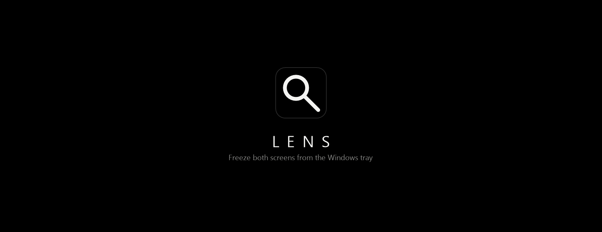
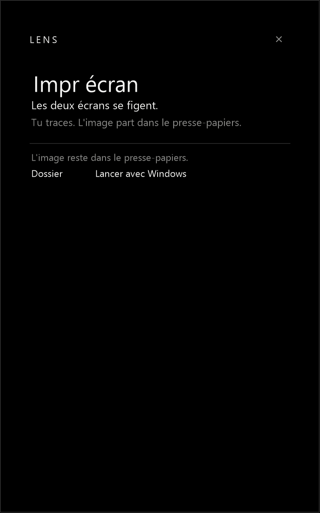

<p align="center">
  
</p>

<p align="center">
  <a href="https://github.com/mnkz/lens/actions/workflows/ci.yml"></a>
  
  
</p>

Lens lives in the notification area. Print Screen freezes every display. You draw the region. The image goes to the clipboard.

<p align="center">
  
</p>

The mark is [`docs/mark.svg`](docs/mark.svg).

## Keys

| | |
| --- | --- |
| Print Screen | Freezes every display. Drag a rectangle. Enter or C copies it. |
| Alt + Print Screen | Takes the foreground window. If that window is Lens, it falls back to the full freeze. |
| Win or Ctrl + Print Screen | Left to Windows. |

Escape leaves the pen, then clears the rectangle, then leaves the freeze. The arrows nudge one pixel. Shift makes that ten. K copies the color under the cursor as `#RRGGBB`. D draws on the freeze. The box at the top offers red, yellow, white, and black, and three widths. Red is the default. The stroke stays in the copy. Ctrl+Z removes the last stroke.

The freeze offers Copier, Texte, Lens, Sauver, and Épingler. Web appears once words are on the rectangle.

| | |
| --- | --- |
| Copier | Bitmap and PNG on the clipboard. |
| Texte | Windows OCR. Drag across the words. Ctrl+A selects them, Ctrl+C copies them. |
| Lens | The crop opens in Google Lens, inside the tray window. |
| Sauver | Writes `Lens` and the time into the Screenshots folder. |
| Épingler | A window on the glass. Drag it. Escape closes it. |
| Web | The selected words open as a Google search. |

A grab always lands on the clipboard, and a copy stays in `%LOCALAPPDATA%\Lens\shots`. Thirty files are kept. The window shows the last crop, its size, the same actions, the text, and the eight newest shots.

Dossier opens the Screenshots folder. Lancer avec Windows writes a Startup shortcut that passes `--tray`. The × or a click outside hides the window. Left-click the icon brings it back. Right-click for Ouvrir, Figer les écrans, and Quitter.

A second copy steps aside. `--freeze` starts a capture. `--tray` starts in the notification area.

## Build

Rust edition 2024, Windows.

```
cargo build --release
```

The binary is `target\release\lens.exe`.

```powershell
$s = (New-Object -ComObject WScript.Shell).CreateShortcut(
  "$env:APPDATA\Microsoft\Windows\Start Menu\Programs\Startup\Lens.lnk")
$s.TargetPath = "$PWD\target\release\lens.exe"
$s.Arguments = "--tray"
$s.WorkingDirectory = "$PWD"
$s.WindowStyle = 7
$s.Save()
```

[MIT](LICENSE).
